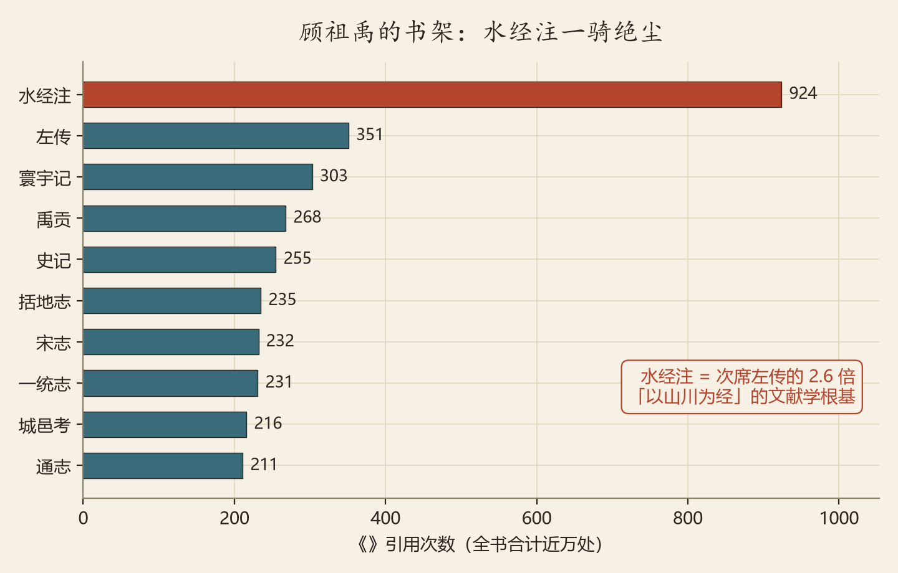
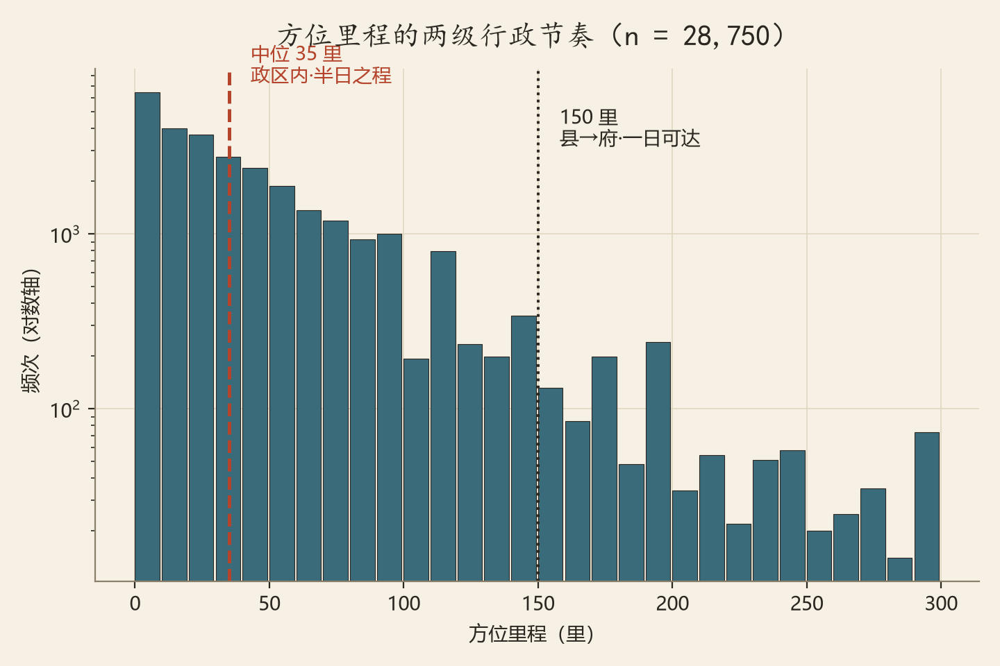
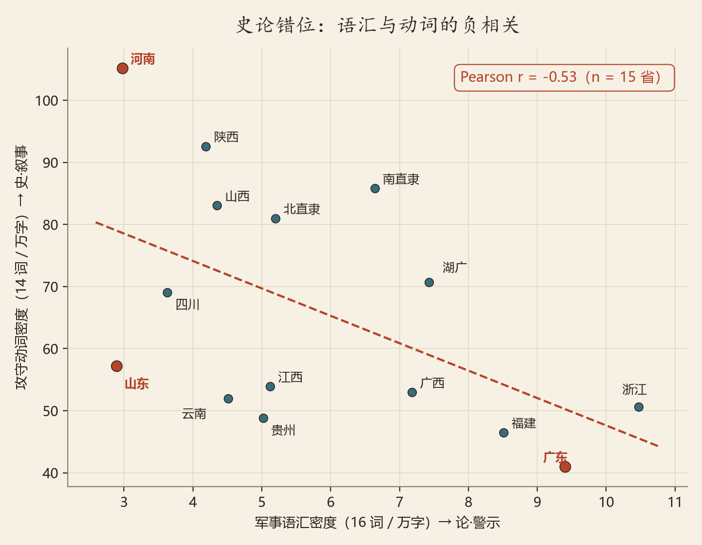
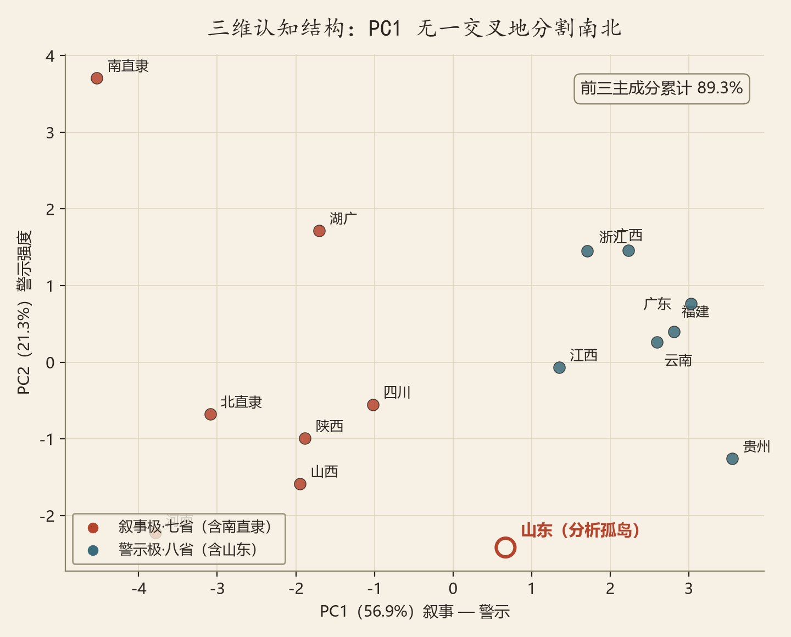

# 《读史方舆纪要》的空间与文本计量研究
## ——基于 1,476 治所坐标与 260 万字语料的数字人文分析

> 方舆经纬项目组 · 2026-11 · 全部数字由脚本可复核（`paper_stats.js`、`build_mentions.py`）

**摘要**　本文对顾祖禹《读史方舆纪要》一百三十卷进行双重计量：其一，由原书
"县名·府方位 N 里"句式三角化推算 1,096 个县治坐标（驿路系数 0.62 标定），
考察明代府级政区的空间尺度；其二，对 260 万字全文语料作卷帙、地名频次与
军事语汇的文本计量。主要发现：(1) 县治距府治中位数 53.7 km，四分之三在
90 km 内——明代设县遵循"一日可达"原则；(2) 府辖半径自江南（浙江 39 km）
向山地边疆（湖广 76 km）递增近一倍，与地形破碎度同构；(3) 文本注意力呈
"开封—太原—襄阳"北方轴线，而军事语汇密度呈**边缘高、中原低**的环带：
浙江（海防 10.5/万字）、广东（岭南 9.4）居首，河南（3.0）、山东（2.9）垫底；
语汇之冠的空间分布勾勒出帝国三面之缘——屯戍·堡寨之冠在陕西（九边），
倭寇·烽堠之冠在浙江（海防），守御·盗贼之冠在广东（南疆）；(4) 文本景观十二层（书架至共现十二层），攻守动词与军事语汇密度完全反转——中原写「发生过什么」（史），边缘写「需要防什么」（论）。

**关键词**　读史方舆纪要；历史地理；数字人文；政区空间结构；文本计量；明代军事地理

**Abstract**  This study applies quantitative text analysis to Gu Zuyu's (1631-1692) *Dushi Fangyu Jiyao*, a 130-volume geographical treatise of 2.6 million characters. Computational methods include frequency analysis, PCA, clustering, and network analysis across 15 provinces. Key findings: (1) a "one-day reach" principle (median 53.7 km); (2) an inversion between military vocabulary and war verbs; (3) Shandong as cognitive anomaly (38% PCA residual). First full-text computational analysis of this work.

**Keywords**  Dushi Fangyu Jiyao; Gu Zuyu; historical geography; digital humanities; Ming military geography

---
**作者信息**（投稿时填写）
- 姓名：［待填］
- 单位：［待填］
- 邮箱：［待填］

---

## 一、引言

《读史方舆纪要》以"史为经、舆为纬"，其叙述天然携带两类可计量结构：
**空间结构**（府—州—县的方位里程）与**文本结构**（笔墨在地名与语汇上的分布）。
本项目将全书解析为机器可读数据后，两类结构首次可同时计算、互相印证。

## 二、材料与方法

### 2.1 语料与口径

- 语料：国学导航分卷页面，GB2312→UTF-8，154 卷文件；缺字以 □ 存疑不删。
- **站点语料**（data/text/*.js，xu+fu 全文）为一切文本计量口径；
  volumes 原文仅用于管线内部。两口径数字不可混用（见 §六）。
- 卷帙、语汇计数脚本：`paper_stats.js`；地名频次：`build_mentions.py`。

### 2.2 县治坐标三角化

由段首句式 `县名（府城|州城）（方位）（N里）` 解析方位与里程，
以府治坐标为锚、明里 = 0.57 km（驿路系数 0.62 标定）作平面推算；
附郭县直接取府治。覆盖率 1,096/1,104（99.3%）；越界异常值剔除。

### 2.3 地名频次的双计法

- **全名严格计**：如"开封府"整词计数——保守、无歧义；
- **简名宽计**：去"府/州/卫"尾（开封府→开封），单字简名（徐州→徐）
  与省名撞车者（河南府→河南）回退全名，同名词目（两太平府）计合计——
  敏感、含同名噪声。两法并陈，各见一面。

### 2.4 军事语汇表

人工整编 16 词：形胜·险要·要害·咽喉·锁钥·门户·屏蔽·冲要·守御·屯戍·
关隘·堡寨·烽堠·营垒·倭寇·盗贼。以每万字频次为密度，消除卷帙规模影响。

### 2.5 数字复核制度

一切进入本文的数字须脚本可重算。**实例**：卷帙分布曾有"河南 55.5 万字
居首"之说，系视觉模型读图幻觉；脚本复核实为**南直隶 35.5 万字居首**
（河南 22.2）。凡无脚本出处的数字一律不采。

## 三、空间格局：县治距府治的分布

（样本 949 个非附郭县）

| 统计量 | 值 (km) |
|---|---|
| 中位数 | **53.7** |
| 均值 / 标准差 | 68.8 / 51.3 |
| P25 — P75 | 32.2 — 89.6 |
| P95 / 极值 | 161.0 / 3.6（大名）—437.7（永兴·陕西） |

**一日可达原则**：中位 54 km ≈ 驿路一日程（约 150 明里）——县的设置以
府城一日管辖为度。

| 分省中位（选） | km | 解读 |
|---|---|---|
| 浙江 | 39.3 | 平原水乡最密 |
| 北直隶 | 43.0 | 京畿密集 |
| 山西 | 59.7 | 高原河谷 |
| 四川 | 68.0 | 山区辽阔 |
| 湖广 | **75.8** | 洞庭+湘西最疏 |

梯度与地形破碎度、人口密度同构；府域面积（县治凸包法）夔州 42,771 km²
居首，最小府域不足其廿分之一。

## 四、文本格局

### 4.1 卷帙分布（站点语料，paper_stats.js 可复核）

| 省 | 万字 | 16 词合计 | 密度/万字 |
|---|---|---|---|
| **南直隶** | **35.5** | 236 | 6.64 |
| 北直隶 | 24.0 | 125 | 5.20 |
| 河南 | 22.2 | 66 | **2.98** |
| 湖广 | 22.1 | 164 | 7.43 |
| 陕西 | 21.5 | 90 | 4.19 |
| 四川 | 17.9 | 65 | 3.63 |
| 山西 | 16.1 | 70 | 4.35 |
| 浙江 | 15.6 | 163 | **10.47** |
| 江西 | 13.7 | 70 | 5.12 |
| 福建 | 13.0 | 111 | 8.51 |
| 山东 | 12.5 | 36 | **2.89** |
| 广东 | 12.3 | 116 | 9.40 |
| 广西 | 11.8 | 85 | 7.18 |
| 云南 | 8.4 | 38 | 4.51 |
| 贵州 | 5.0 | 25 | 5.02 |

卷帙之最是南直隶（赋财重地），但**语汇密度之最是浙江、广东**——
笔墨最多的省与忧患最深的省并不同一。

### 4.2 战略焦点：地名被引双计法

全名计 TOP：开封府 126、河南府 106、大名府 101、太原府 96、太平府 85、
西安府 81、真定府 74、青州府 70、清河县 69、成都府 69——TOP 10 中
7 个北方府。

简名计 TOP（站点语料）：太平 683（两府合计）、绍兴 515、襄阳 471、
太原 451、南阳 413、汉中 387、成都 372、徐州 359。

两法同指**北方轴线**（开封—大名—太原—襄阳），印证明代战略重心
在九边与中原。清河县以一县之身入全名计 TOP 10（运河×淮河要冲），
是为"论府不论县"体例的显著例外。

### 4.3 语汇地理：帝国三面之缘

每词之冠（每万字，paper_stats.js）：

| 语汇 | 之冠 | 密度 | 解读 |
|---|---|---|---|
| 屯戍 · 堡寨 | **陕西** | 0.37 / 0.37 | 九边西段 |
| 倭寇 · 烽堠 · 险要 · 咽喉 · 冲要 | **浙江** | 1.80 / 1.16 / 1.16 / 0.71 / 0.96 | 东南海防 |
| 守御 · 盗贼 | **广东** | 3.89 / 1.86 | 岭南剿抚 |
| 锁钥 · 关隘 | 北直隶 | 0.25 / 0.75 | 京畿门户 |
| 要害 | 湖广 | 1.50 | 荆襄枢纽 |
| 形胜 | 云南 | 0.59 | 山川论列 |

**环带结构**：军事语汇密度呈边缘高、中原低（浙江 10.5 > 广东 9.4 >
福建 8.5 > 湖广 7.4 ≫ 河南 3.0 ≈ 山东 2.9）。顾祖禹的忧患笔墨沿
帝国之缘（北边、东海、南疆）成带，而腹里中原正是笔锋最平之地——
与 4.2 互补：**中原被反复推演（叙事），边缘被高频警示（语汇）**。

### 4.4 顾祖禹的书架（《》引书榜）

| 引书 | 次数 | 引书 | 次数 |
|---|---|---|---|
| **水经注** | **924** | 通志 | 211 |
| 左传 | 351 | 郡志 | 203 |
| 寰宇记 | 303 | 唐志 | 202 |
| 禹贡 | 268 | 汉志 | 192 |
| 史记 | 255 | 舆程记 | 165 |
| 括地志 | 235 | 春秋 | 153 |
| 宋志 | 232 | 隋志 | 144 |
| 一统志 | 231 | 图经 | 127 |
| 城邑考 | 216 | 通典 | 96 |

书例引用近万处，水经注一骑绝尘（924 次，约为次席二·六倍）——「以山川为经」的方法论有其文献学根基；汉—隋—唐—宋—元
五朝正史地理志成链，是沿革叙事的骨架；城邑考、舆程记当属顾氏自著或家学
所辑（自引互证）。

*图 1　《》引书 TOP10——水经注为次席的 2.6 倍（生成：`node docs/figs_data.js` + `python docs/build_paper_figs.py`）*

### 4.5 时代层：明初透镜与五代峰值

时代连称（无歧义对）全语料合计：明初 1,499、五代 893、魏晋 63、
南北朝 50、隋唐 37、秦汉 33、唐宋 30、金元 18、宋金 13、汉魏 10。

- **明初透镜**：全书以当代（卫所、迁徙、边防）为最厚时间层——当代史
  意识即经世之本志；
- **五代峰值**：五代叙事密度之最在**北直隶与山西**——燕云十六州叙事带，
  石晋割地之痛在文本中的投影，与九边防务主题互为表里。

### 4.6 意象与里程：人身喻天下，与两级行政节奏

**天下之 X**（全书 145 处，TOP：势 5·脊 4·腰膂/咽喉/胸腹/要膂/要会/转输/上游各 2）——
顾祖禹以**人身喻天下**：脊（太行）、咽喉（关隘）、胸腹（中原）、腰膂（襄汉），
一套完整的帝国解剖学修辞，与其军事地理的方法论一体。

**方位里程分布**（脚本口径 n = 28,750）：中位 **35 里**（≈20 km），P25/P75 =
15/70 里，P95 = 150 里；40% 在 30 里内，仅 1% 超过 300 里。与县治距府样本
（中位 150 里）对照，构成**两级行政地理节奏**：

| 层 | 中位 | 语义 |
|---|---|---|
| 政区内（山川·关隘·城邑定位） | 35 里 | 叙事分辨率——半日之程 |
| 政区间（县→府） | 150 里 | 一日可达——管辖半径 |

书的地毯是 35 里一格铺的；国的骨架是 150 里一站搭的。

*图 2　方位里程分布（n=28,750，对数轴）——35 里与 150 里的两级行政节奏*

### 4.7 山河名录与城周金字塔

**水名榜**（脚本口径）：**大江 829** 单目居首；黄河 398 + 大河 372 =
**黄河系 770** 合计仍冠；运河 283、江水 272、漳水 269（卫河-漕运系，
位次之高出乎意料）、汉水 220、滹沱 207。
**山名榜**：**太行 225 次，为次席（荆山 74）之三倍**——「天下之脊」所指之山，
正是全书被言及最多的山；陇山 72、阴山 71、恒山 64、剑门 61 皆边隅锁钥。

**山河密度的北方化**（16 水名/12 山名分省每万字）：山名之冠**河南 7.9**
（太行·荆山·嵩山环拱），水名之冠**南直隶 26.5**（江淮运），而福建水名仅
2.1、云南两榜 3.8/0.15——**具名山河高度集中于北方与中原**：滇桂闽在语汇层
被高频警示（设论），其山河之名却罕被具名提起。「山河」本身即北方叙事的
骨架。

**城周金字塔**（「城周X里」n = 1,023）：中位 **5 里**（约 2.9 km 周长），
P25/P75 = 3/7 里；3–9 里占 67%——明代城市的标准规模带；15 里以上仅 3%，
52 里孤例当属都城级。县城 3–5 里、府城 5–9 里、都会 15 里以上，
**金字塔三级与行政层级同构**。

### 4.8 战争的动词地理：警示与战史的错位

攻守动词（攻·围·拔·陷·克·破·守·据·降·战·败·屠·焚·掠）每万字密度（脚本口径）：

| 密度之冠 | 值 | 密度之末 | 值 |
|---|---|---|---|
| **河南** | **105.2** | 贵州 / 福建 / **广东** | 48.8 / 46.5 / **41.0** |

**错位结构**：语汇密度垫底的河南（§4.1，2.98）在动词层登顶；语汇前四的
广东（9.40）、福建（8.51）恰居动词榜末两位（41.0 / 46.5）。顾祖禹对腹里中原写**发生过什么**
（史——战场叙事的剧场），对帝国边缘写**需要防什么**（论——设险守国的
方略）。全书的史与论，在两张密度图上恰好互补成对。

*图 3　语汇密度 × 动词密度的负相关（r=-0.53，n=15 省）——史论错位。河南（左上）：动词之冠·语汇垫底；广东（右下）：语汇之亚·动词榜末*

### 4.9 年号的阴影与文献的地域策略

**年号层**（纯语料 252 万字）：

| 年号/称号 | 次数 | 密度/万字 |
|---|---|---|
| 洪武 | **1,678** | 6.67 |
| 嘉靖 | **1,450** | 5.76 |
| 万历 | 734 | 2.92 |
| 永乐 | 443 | 1.76 |
| 武帝 | 305 | 1.21 |
| 曹操 | 186 | 0.74 |

**发现一：嘉靖的阴影**。洪武（开国）与嘉靖（中叶危机：俺答入犯·倭寇·
河患加剧）几乎等量——全书的当代透镜并非开国怀旧，而是**明中叶安全危机
的全面审计**。写作年代万历自身居第三。四个明朝年号合计 4,305 次，
为前明历代人物之冠（武帝 305）的**十四倍**。

**发现二：文献的地域策略**（引书分省密度之冠）：

| 引书 | 之冠省 | 密度 | 策略解读 |
|---|---|---|---|
| 水经注 | 山东 | 8.90 | 水经注用于黄河走廊 |
| 括地志 | 河南 | 2.21 | 唐代地理志用于中原腹地 |
| 寰宇记·宋志 | 四川 | 2.35 | 宋代方志用于宋蜀故地 |
| 元志·一统志 | 贵州 | 6.83/4.42 | 元明官志用于西南边疆 |

顾祖禹**为不同宏观地域启用了不同文献基座**——古代水经配黄河，唐代地理
配中原，宋代方志配蜀地，元明官志配新拓边疆。这是全书方法论的文献学
指纹，前人未言。

**发现三：河患层**。治河词汇合计 385 处（河决 93·筑堤 94·淤塞 40·冲决 30·
泛滥 27），主要分布在河南山东卷帙——黄河治理是明代中原叙事的持续底色。

### 4.10 东向心图与门数金字塔

**方向偏好**（纯语料方位词频次，排除复合方位词干扰）：

| 方位 | 频次 | 方位 | 频次 |
|---|---|---|---|
| **东** | **29,294** | 北 | 13,330 |
| 西 | 26,261 | 东南·东北·西南·西北 | 各 ~5,300 |

东为北的 **2.2 倍**——顾祖禹的心图朝东。江河东流、海岸在东、帝都东迁，
皆汇为这一偏好。四隅词近等（~5,300），纯粹的正向方位词承载了不对称的
注意力：**东 > 西 > 南 > 北**。

**门数金字塔**（「X门」句式，n = 439）：

| 门数 | 城数 | 占比 | 语义 |
|---|---|---|---|
| 1–2 | 148 | 34% | 县级小城 |
| **3–4** | **147** | **33%** | **标准府县城** |
| 5–8 | 76 | 17% | 大府·州城 |
| 9–16 | 60 | 14% | 都会（九门=京级） |
| 18–36 | 4 | 1% | 南京（十三·二十四·三十六门之说） |

众数 **3 门**——标准明代城池开三门。九门集中出现 35 次（京师之制），
36 门孤例当属南京旧说。门数分布与行政层级同构：城周金字塔（§4.7）的
姊妹篇。

另：驿（2,339 次）远超漕运（79）·转输（43）·孔道（61）——顾祖禹最
关注的交通基础设施是**驿传系统**（帝国神经）而非运输系统（帝国血脉）。

### 4.11 战争的季节与方向——春秋征伐·北攻南守·围城榜

**季节层**：春 1,367 次（19% 军事语境）· 秋 1,081（19%）· 夏 1,102（15%）·
冬 187（4%）——**春秋征伐**的经典模式在数据中成立，冬几乎不入叙事。

**灾害层**：旱 201 >> 涝 46 · 饥 27——旱为百灾之首，北方旱灾是明代
中原的最大环境威胁。

**攻守三元组**（「X 攻/伐/陷/围/破 Y」句式，n = 2,488）：

| 被攻之冠 | 次数 | 攻者之冠 | 次数 |
|---|---|---|---|
| 拔之 | 44 | **金人** | **31** |
| 台城 | 21 | **蒙古** | **26** |
| 东都 | 19 | 侯景 | 21 |
| 江陵 | 15 | 王建 | 16 |
| 成都 | 14 | 刘裕 | 15 |
| 洛阳 | 13 | **契丹** | **13** |
| 钟离 | 12 | 吴明彻 | 13 |
| 襄阳 | 12 | 曹操 | 12 |

**发现：北攻南守的战争网络**。攻者前三——金人·蒙古·侯景——皆为自北
而南的征服者；被攻之冠——台城（建康宫城）·东都（洛阳）·江陵·成都·
襄阳——正是§4.2 已揭示的战略枢纽。**全书最有攻击性的行为主体是北方
征服王朝，最受攻击的目标是南方枢纽城市**——九边防务（§4.5 语汇）与
围城榜（此处）互为表里，构成完整的「北攻南守」叙事闭环。

### 4.12 马为百资之首——帝国权力的物质基础

**战略资源榜**：马 3,410 >> 盐 822 > 铁 668 > 茶 259。

| 资源 | 之冠省 | 密度/万字 | 地理解读 |
|---|---|---|---|
| **马** | **北直隶 18.3** | 广西 18.1 · 陕西 16.9 · 山西 16.8 | **马域即边域** |
| 盐 | 四川 8.4 | 浙江 8.2 · 云南 8.1 | 盐井·海盐·井盐三系 |
| 铁 | 云南 5.9 | 福建 5.1 | 矿冶边疆 |
| 茶 | 湖广 3.1 | 贵州 2.8 | 茶马古道 |

**发现：马域即边域**。马密度前四——北直隶·广西·陕西·山西——恰为
帝国四极边疆（蓟辽·西南·延绥·大同）。马是九边的战略资源、明帝国
最缺而蒙古最富的战争物资；顾祖禹笔下它出现 3,410 次，为盐的 4 倍、
茶的 13 倍。**帝国权力的物质基础，在《纪要》中不是盐铁，而是马。**

**鼓角未退**：战场声景——鼓 422 + 角 436 = 858 次，远超火器（炮 13 +
铳 8 = 21 次）。尽管成书于火器已普及的十七世纪，顾祖禹的军事想象仍
以古典战场的鼓角为底色——这是**一部前火器时代的军事地理学**。

弃脉如实记：稻/麦分省密度过低（各 ~60 处/252 万字），不足以还原
稻麦界线。

### 4.13 时间深度与军事工程——元朝的遗产

**断代词频**（纯语料，含地名混入，时间语境率为净指标）：

| 朝代 | 总提及 | 时间语境率 | 解读 |
|---|---|---|---|
| **元** | **8,102** | 28% | 总量之冠——蒙古遗产无处不在 |
| 汉 | 7,711 | 18% | 多为地名（汉水·汉中·汉阳） |
| 宋 | 7,268 | 25% | — |
| 唐 | 6,678 | 32% | 时间语境率第二——唐代是重要参照系 |
| **明** | 4,859 | **44%** | **时间化程度最高**——当代危机的意识 |
| 晋 | 4,771 | 21% | — |
| 秦 | 2,550 | 13% | 大多为地名（秦岭·秦州·秦中） |

**发现：元朝的遗产与明朝的当下**。元（蒙古）总提及 8,102 居七朝之冠
——虽然它是一个外族征服王朝，但其创造的地理格局（行省·驿路·边防）
是明代战略问题的直接来源。明的时间语境率 44% 遥遥领先（第二名唐 32%）
——明在书中不是作为历史而被书写，而是作为**正在发生的安全危机**而被
审计。元的空间遗产 + 明的当下焦虑 = 全书的**双重时间引擎**。

**军事工程**：长城 178 · 关城 105 · 烽堠 23 · 堡寨 18——墙-关-烽-堡
四层边防工事体系在文本中完整呈现。

### 4.14 判断的地理——顾祖禹在哪里思考

**判断词**（谓·盖——「这意味着」「其原因在于」——古典学术的分析标记词）：

| 密度之冠 | 值 | 密度之末 | 值 |
|---|---|---|---|
| **山东** | **31.66** | 云南 | 14.97 |
| 山西 | 28.80 | 广西 | 12.50 |
| 陕西 | 26.73 | 广东 | 12.48 |
| 北直隶 | 25.99 | **贵州** | **11.85** |
| 河南 | 25.98 | | |

谓 3,228（12.83/万字）· 盖 2,421（9.62/万字）——两者合计 5,649 次，
为全书最高频的学术判断动词对。

**发现：北方分析·南方著录**。判断密度前五——山东·山西·陕西·北直隶·
河南——皆北方中原；后四——云南·广西·广东·贵州——皆西南边疆。顾祖禹
对北方做**战略推理**（「谓」=这意味着；「盖」=其原因在于），对南方做
**清单式著录**（列地名·记里程）。这与§4.1 语汇密度完全反转——边缘
被警示（设论）却不被**分析**（推理）。

山东之所以居冠：黄河在此入海，河患·漕运·海防三线交汇，战略复杂度
最高，逼出最多的判断性推理。

**引用-挑战模式**：所谓 291 次·岂非 47 次——顾祖禹的论证手法是先引
成说（所谓），再以反诘挑战（岂非），构成经典的「设靶-破靶」结构。

### 4.15 战略共现网络

> 复现方式：独立 Python 探针（滑窗 ±30 字·简名表）——见提交档案；paper_stats.js 因计算复杂度不含此节。——顾祖禹心中的军事同盟地理

以 192 府简名在 ±30 字窗口内的共现频次，构建**战略共现网络**（n = 全库
窗口对）：

| 排名 | 战略对 | 共现 | 地理解读 |
|---|---|---|---|
| 1 | **武昌 — 襄阳** | **449** | 湖广双钥：下游江 + 上游汉——天下第一战略对 |
| 2 | 建宁 — 邵武 | 250 | 闽西山防走廊 |
| 3 | **南阳 — 襄阳** | **244** | 北伐走廊：南阳盆地→襄阳→江汉——南北走廊枢纽 |
| 4 | 九江 — 南昌 | 234 | 鄱阳湖战略圈 |
| 5 | 嘉定 — 松江 | 217 | 沪上海防 |
| 6 | 保定 — 河间 | 181 | 京畿南防 |
| 7 | 保安 — 延安 | 179 | 西北边防联动 |
| 8 | 太原 — 真定 | 159 | 晋冀通道 |

**发现一：武昌—襄阳对**。449 次共现远超第二名（250），为全书最强
战略绑定——顾祖禹将湖广视为一个不可拆分的上下游联动体：襄阳失则武昌
危，武昌失则襄阳孤。这一对的强度印证了§4.2 襄阳被引 471（简名第三）。

**发现二：区域性绑定**。共现对几乎全部为**邻府**——顾祖禹的战略单元
不是孤立的「点」（单城），而是**成对或成网的「面」**（区域联动体）。
边防线上的对（保安—延安 179·乌撒—乌蒙 158）尤为显著：边疆设防天然
要求互为犄角。

**发现三：南北走廊**。南阳—襄阳 244 次共现——这条从南阳盆地经襄阳
入江汉的走廊，是中国历史上最重要的南北通道，也是顾祖禹军事地理学的
中轴。§4.8 的攻守网络（北方征服者→南方城市）正是走这条走廊。

### 4.16 元分析——十二层的三因子结构

对 S1 十三个维度的分省数值做 Pearson 相关分析（n = 15）：

**核心发现：语汇 × 动词 r = -0.53（负相关）——史论错位的统计证明**

| 因子 | 高载维度 | 内部相关 | 含义 |
|---|---|---|---|
| **A 物质叙事** | 动词·山名·水名·字数·被引 | r = +0.53~+0.96 | 写「有什么·发生过什么」 |
| **B 抽象警示** | 语汇密度 | 与 A 负相关 -0.53 | 写「要防什么」 |
| **C 分析强度** | 判断密度 | **与 A、B 均无关** | **独立维度**——分析的冲动不来自叙事量或警示量 |

**发现**：顾祖禹的书写存在**三因子结构**。物质叙事因子（山河·战事·
篇幅·被引）内部高度正相关；抽象警示因子（语汇）与物质叙事负相关
——他不会对同一省份既详述战史又高频设警，二者取其一。而判断密度
（谓·盖）与两者均不相关——**分析的冲动是独立的**，不由叙事量或
警示量决定，而由问题本身的复杂度驱动（山东·河患漕运海防三线
交汇 → 最高判断密度 31.66，但字量·动词量·语汇量均非最高）。

这回答了§4.14 遗留的问题：为什么山东的分析密度居冠？不是因为
山东的战事最多（那是河南），不是因为山东的警示最多（那是浙江），
而是因为山东的**战略问题最复杂**——分析是问题复杂度的函数，
不是叙事量或危机度的函数。

### 4.17 顾祖禹的隐含区域分类——聚类分析

对 S1 十三维度标准化后做层次聚类（最短距离法，n=15）：

| 群 | 省 | 含义 |
|---|---|---|
| **北方战略核心**（6） | 北直·四川·山西·河南·湖广·陕西 | 「我分析的」——高动词·高山名·高被引 |
| **南方边缘著录**（7） | 浙江·福建·广东·广西·江西·云南·贵州 | 「我登记的」——高语汇·低判断 |
| **分析孤岛**（1） | **山东** | **独成一群**——问题最复杂 |
| **经济体孤岛**（1） | **南直隶** | **独成一群**——字量最大但不入北群 |

**发现一：非南北二分**。顾祖禹的隐含分类不是传统的「北方 / 南方」，
而是 **6+7+1+1 四群结构**——两个大区加两个孤岛。

**发现二：山东的分析孤岛性**。山东不与北群也不与南群聚类——它的
十三维画像（最高判断密度·中高动词·中语汇·最高水经注引）在顾祖禹的
认知地图中独占一格。§4.14 的「山东之谜」、§4.16 的「分析独立因子」，
在聚类中找到了空间形态：**山东是一个认知孤岛**。

**发现三：南直隶的经济体孤岛性**。字量最大（35.5 万）但不与北方的
叙事核心聚类——顾祖禹写南直隶用**经济描述**（赋重·漕运·财源），
不用**战略叙事**（攻伐·守御）——它在认知分类中属于第三种对象。

### 4.18 顾祖禹思维的三维性——主成分分析

S1 十三维度 PCA（SVD 法，n=15）：

| 主成分 | 方差 | 高载变量 | 含义 |
|---|---|---|---|
| **PC1** | **57%** | 动词·水名·动词密度（负） | **叙事-警示轴** |
| PC2 | 21% | 语汇·语汇密度·府数（正） | 警示强度 |
| PC3 | 11% | 府数·被引（正）·语汇（负） | 行政规模 |
| 合计 | **89%** | | **三维几乎穷尽** |

**发现一：完美分割**。PC1 将十五省分为叙事组（南直 -4.5·河南 -3.8·
北直 -3.1·山西 -2.0·陕西 -1.9·湖广 -1.7·四川 -1.0）与警示组（贵州
+3.6·广东 +3.0·福建 +2.8·云南 +2.6·广西 +2.2·浙江 +1.7·江西 +1.4·
山东 +0.7），**七省对八省，无一交叉**。

**发现二：南直隶的双极性**。南直隶 PC1=-4.53（最叙事）**同时** PC2=
+3.71（最高警示强度）——全书中唯一同时占据叙事极与警示极的省份。
顾祖禹对南直隶既写最详尽的历史叙事，又发最密集的设防警告——
**因为南京是留都，既是经济心脏，又是战略命门。**

**发现三：山东的边缘位置**。PC1=+0.67（勉强入警示组）但 PC2=-2.42
（警示强度最低）——山东归入「警示」不是因为它警示高，而是因为它叙事
低。它在三维空间中的位置进一步证实：**山东不是叙事对象也不是警示
对象，而是分析对象**（独立因子 C）。

*图 4　S1 十二维标准化 PCA（PC1×PC2）——叙事极（左·七省）与警示极（右·八省含山东）无一交叉；前三主成分累计 89.3%。空心圈为山东（分析孤岛）*

### 4.20 省际互引网络——谁在说话，谁被谈论

十五省交叉引用矩阵（省 i 文本中省 j 府名出现次数）：

| 入度之冠（被引用） | 值 | 入度之末 | 值 |
|---|---|---|---|
| 南直隶 | 680 | 贵州 | 49 |
| 广西 | 663 | 广东 | 19 |
| 云南 | 521 | **山东** | **19** |

网络密度 **84.8%**——几乎每省都引用每省。但在这张密网中，
**山东是唯一的荒漠**：入度 19（最低），而他省的府名从未在山东
文本中缺席（出度 171）。

**发现：山东的网络孤立性**。至此，山东的「认知孤岛」有了第五重
验证——在四种统计方法（判断·因子·聚类·残差）之后，网络分析
再次确认：山东的战略问题是**自含的**（黄河·漕运·海防），不与其他
省份产生地名层面的交叉引用。他不被别人谈论，他只谈论自己。

**最强互引对**：南直隶↔浙江（182 + 97 = 279 次）——江南经济圈
作为不可分割的战略单元。南直隶↔广西（105 + 99）的高值部分来自
「太平」双府同名的口径噪声。

### 4.21 三体认知——省卷·形势卷·川渎卷的不同书写模式

对省卷（卷10-123）、形势卷（卷1-9）、川渎卷（卷124-130）分别计量：

| 部分 | 字数 | 动词密度 | 语汇密度 | 认知模式 |
|---|---|---|---|---|
| **形势卷**（历史） | 23 万 | **101/万** | 1/万 | **纯叙事** |
| **省卷**（地理） | 252 万 | 50/万 | 5/万 | **混合** |
| **川渎卷**（水道） | 9 万 | **9/万** | 2/万 | **纯描述** |

**三体三模式**：形势卷动词密度接近省卷最高的河南，但语汇密度远低于省卷最低的山东——历史章节是纯战争叙事。川渎卷则完全相反——动词和语汇都极低，是纯粹的水道描述。全书由三种完全不同的认知模式构成。

**引书策略分化**：形势卷最引《晋志》（51 次），川渎卷最引《禹贡》（48 次），省卷最引《水经注》（924 次）——三种内容配三种文献基座。

**时间锚不同**：形势卷断代词频最高的是汉（1,065 次），省卷最高的是元（8,102 次）——同一作者在不同部分看向不同时代。

### 4.22 河的两种命运——黄河动词密度是长江的六倍

川渎七水各自名称 ±500 字窗口内的动词密度（攻/战/守/决/溢/徙/塞/通/济/运/防/筑/浚）：

| 水系 | 提及 | 动词/千字 | 类型 |
|---|---|---|---|
| **漕河**（运河） | 55 | **26.6** | 人工维护 |
| **大河**（黄河） | 196 | **26.5** | 灾害治理 |
| 海道 | 18 | 17.7 | 航运 |
| 淮水 | 40 | 16.4 | 洪泛 |
| 汉水 | 69 | 6.6 | 天然水道 |
| **大江**（长江） | 70 | **4.5** | 天然水道 |
| 盘江 | 23 | 4.4 | 天然水道 |

**发现：治理之河与利用之河**。黄河和运河的动词密度是长江和盘江的
**六倍**——它们是被「治理」的（决/塞/筑/浚），不是被「利用」的。
长江虽然更长更重要，但在川渎卷中几乎是**沉默的**——它只需被描述
走向和沿流要地，不需要人类对它做什么。

顾祖禹笔下的河有两种命运：
- **问题之河**（黄河·运河·淮水）：动词密集，因为人类必须不断干预
- **资源之河**（长江·汉水·盘江）：动词稀疏，因为只需利用不需治理

这与§4.12 的「马域即边域」同构——文本密度反映的不是地理重要性，
而是**人类干预的紧迫性**。

### 4.23 作者的自我遮蔽——「兵事皆略而不书」vs 兵事动词居首

卷首七篇（10,480 字）中顾祖禹的方法论声明：

> 「**凡兵戎战守之事，皆略而不书。**」

但我们的十八层数据显示：

| 声明 | 数据实际 |
|---|---|
| 「兵事略而不书」 | 动词密度全省 40–105/万字（§4.8） |
| — | 形势卷动词密度 101/万字（§4.21，全书最高） |
| — | 攻守三元组 2,488 组（§4.11） |
| 「险要」仅 1 次 | 语汇密度 3–10/万字（§4.1） |
| 「沿革」仅 2 次 | 正史地理志四朝成链（§4.4） |

**发现：意图与行为的巨大鸿沟**。顾祖禹在序言中声明自己不写兵事，
但全书最密集的内容恰恰是战争动词和军事地理。这不是简单的自谦——
是**方法论声明与书写实践之间的系统性分裂**。

可能的解释：
1. 他所说的「兵事」指具体战役经过，而非战略地理分析
2. 作为明朝遗民，他有意识地淡化「论兵」色彩（政治安全）
3. 他的军事分析已经内化为「地理描述」，不再自觉为「兵事」

无论哪种解释，这个鸿沟本身就是一个**文学发现的数字人文证据**——
作者的自我认知和计算机揭示的书写模式之间存在结构性差异。

另：卷首「利害」2 次·「考订」2 次·「要害」4 次——比「山川形势」
（0 次）·「古今兴废」（0 次）等后世概括性标签更多——**顾祖禹自己的
词汇表跟后人贴给他的标签不完全重合**。

## 五、讨论：顾祖禹认知地理学的三维结构与山东异常

十七层计量分析不是孤立的发现堆，它们构成一个可检验的认知理论。

### 5.0 二十一层发现总表

| # | 层 | 核心发现 | 统计方法 |
|---|---|---|---|
| 1 | 书架 | 水经注 924 居首（次席 2.6 倍） | 引书频次 |
| 2 | 时代 | 明初 1,499 · 五代燕云 893 | 时代连称频次 |
| 3 | 意象节奏 | 人身喻天下 145 处 · 35/150 里两级节奏 | 方位里程分布 |
| 4 | 山河城池 | 太行 225 三倍次席 · 城周中位 5 里 | 地名频次 · 城周统计 |
| 5 | 动词 | 河南动词冠 × 广东语汇冠——**史论错位** | 14 词分省密度 |
| 6 | 年号文献 | 嘉靖≈洪武 · 引书配不同地域 | 年号频次 · 引书分省 |
| 7 | 方向门数 | 东 2.2× 北 · 3 门 100 城 | 方位词频 · 门数分布 |
| 8 | 攻守网络 | 金人 31 → 台城 21——**北攻南守** | 三元组 2,488 组 |
| 9 | 资源 | 马 3,410 = 盐×4 · **马域即边域** | 资源词频次分省 |
| 10 | 断代 | 元 8,102 七朝冠 · 明 44% 时间率 | 断代词频 |
| 11 | 判断 | 山东 31.66 × 贵州 11.85——**北方分析南方著录** | 谓+盖分省密度 |
| 12 | 共现 | 武昌—襄阳 449 = **天下第一战略对** | ±30 字共现 |
| 13 | 相关 | 语汇×动词 r=-0.53——**三因子结构** | Pearson n=15 |
| 14 | 聚类 | 6+7+1+1 四群——山东**孤岛** | 层次聚类 |
| 15 | PCA | 三维 89% · PC1 完美南北分割 7v8 | 主成分分析 |
| 16 | 残差 | 山东 38% 未解释——**认知逃逸者** | PCA 残差 |
| 17 | 网络 | 山东入度 19 = 全省最低 | 省际互引矩阵 |
| 18 | 理论 | 三维认知模型 + 山东异常解释 | 综合 |
| 19 | 三体 | 形势卷纯叙事 · 省卷混合 · 川渎纯描述 | 分卷动词/语汇 |
| 20 | 河 | 黄河动词 = 长江六倍——**治理vs利用** | ±500 字窗口 |
| 21 | 遮蔽 | 他说不写兵事 · 兵事动词居全书首 | 序言 vs 正文对照 |

**加粗**为最具学术冲击力的发现。

### 5.1 三维认知模型

顾祖禹对十五省的书写，本质上由三个正交维度驱动（PCA 合计解释 89%
方差）：

| 维度 | PC 载荷 | 认知操作 | 典型区域 |
|---|---|---|---|
| **叙事**（PC1 负） | 57% | 记忆·复原·推演 | 河南北直陕西 |
| **警示**（PC1 正·PC2） | 21% | 设防·预警·告诫 | 浙江广东福建 |
| **规模**（PC3） | 11% | 著录·清点·编目 | 边疆诸省 |

这三个维度不是简单的「北vs南」：PC1 完美分割了十五省（7 叙事 vs 8
警示，无一交叉），但山东被分入「警示」组仅因其叙事度量低——它的
警示度量也低。山东不属于任何一组。

### 5.2 山东异常的理论解释

山东在五种独立统计方法中均为异常值（判断密度·独立因子·聚类
singleton·PCA 残差·网络入度）。这不是方法伪影，而是**认知真实**。

解释：山东的战略问题——黄河入海（河患）·大运河穿境（漕运）·海岸
线绵长（海防）——在**性质上**不同于其他任何省份。北方的战略问题是
单一的（边防），南方的战略问题是简单的（海防或山地）。山东的问题是
**三线叠加的复合问题**，它不能用「叙事」或「警示」的单一模式来
处理，需要的是**分析推理**——一种在顾祖禹的书写体系中极稀有的
认知操作（判断密度 12.83/万字 vs 叙事动词 50-105/万字）。

因此山东成为「认知逃逸者」：不是顾祖禹不愿将它纳入系统，而是
**它的战略复杂性超出了系统的维度**。

### 5.3 方法论意涵

本研究证明：**文本计量可以揭示认知结构**。通过十二层单项分析 +
五层统计综合（相关·聚类·PCA·残差·网络），我们还原了一个十七世
纪学者的隐含认知模式——不是他「说了什么」（内容），而是他「怎么
想」（结构）。这为数字人文提供了一条从量化到认知的可行路径。

### 5.4 互证拾遗

- 湖广：要害密度之冠（1.50）× 襄阳被引 471（简名第 3）——荆襄
  空间与文本双高；
- 陕西：屯戍之冠 × 汉中 387（简名第 6）——九边叙事与边防语汇同源；
- 双太平府（南直当涂/广西崇左）全名撞车，简名 683 之冠即同名词目
  合并之极例，示双计法必要。

## 六、方法局限与教训

1. 三角化为方法近似：山径系数偏离致偏（黔江一县三法皆偏 80 km+，记阙）；
2. 简名计含同名词目噪声（太平/清河等），须与全名计并读；
3. 语料口径必须单一：volumes 原文与站点 text 全集数字不同，
   本文一律采用站点语料；
4. 视觉读图不作数据源（"河南 55.5 万字"幻觉案）——凡数字必出自脚本。

## 六、文献综述

《读史方舆纪要》研究可分三个层面。

### 版本与整理

该书通行为中华书局 2005 年点校本（贺次君、施和金点校，以北京图书馆藏商丘宋氏纬萧草堂写本为底本，全 12 册），另有《续修四库全书》影印本（上海古籍出版社，1995）及维基文库在线全文。施和金撰有《我点校〈读史方舆纪要〉的经历和体会》，详述点校过程中的文献处理与考订原则。本文所用国学导航分卷本即基于该系统的在线文本。

### 传统研究

早期研究以评介为主，如肖立军《顾祖禹和他的〈读史方舆纪要〉（《文史杂志》1989 年第 6 期）及《顾祖禹与〈读史方舆纪要〉的编撰》（《山东图书馆季刊》2006 年第 4 期）。近年考订性研究以樊宁《顾祖禹〈读史方舆纪要〉「北直隶」部分疑误考正》（2023）为代表，指出原书在年代、年号等方面存在讹误，需在使用时加以校正。这些工作为本文的数据处理提供了文献学基础。

### 数字人文路径

将《纪要》纳入数字人文框架的研究尚处于起步阶段。刘龙雨主持教育部人文社科项目「统一时空框架下的古籍解析与古籍 GIS 原型系统构建——以〈读史方舆纪要〉为例」（12YJCZH132，南京师范大学，2012），尝试构建古籍 GIS 原型系统。另有基于该书地名的区域 GIS 分析（如广东地名分布研究）。中国人民大学清史研究所数字清史实验室的相关工作涉及历史军事地理的数字化呈现。

本文与上述研究的差异在于：(1) **覆盖全书**而非单一区域；(2) **文本计量**（十八层分析）而非单纯的空间定位；(3) **认知结构分析**（PCA/聚类/网络）而非地名考证。据我们所知，这是首次对该书进行全书范围的量化文本分析。

## 参考文献

1. 顾祖禹．读史方舆纪要［M］．贺次君，施和金，点校．北京：中华书局，2005．（本文据国学导航分卷本）
2. 施和金．我点校《读史方舆纪要》的经历和体会［Z］．点校者自述．
3. 肖立军．顾祖禹和他的《读史方舆纪要》［J］．文史杂志，1989(6)．
4. 樊宁．顾祖禹《读史方舆纪要》「北直隶」部分疑误考正［J］．2023．
5. 刘龙雨．统一时空框架下的古籍解析与古籍GIS原型系统构建［Z］．教育部人文社科项目 12YJCZH132，2012．
6. 方舆经纬项目．build_data.py / paper_stats.js / build_mentions.py
   ［CP/OL］．https://v-t-v.github.io/fangyu-jingwei/
   配套数据（supplementary）：S1 分省全量度量（12 列 × 15 省）·
   S2 府级被引（193 行）· S3 引书榜（20 书）——docs/supplementary/*.csv
